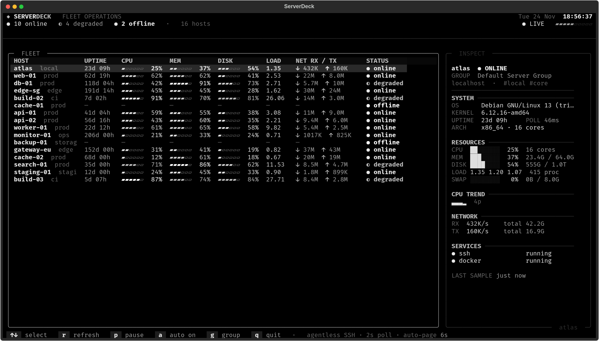

# ServerDeck

**面向无桌面 Linux 服务器的彩色终端服务器状态面板。**

本地机器和远程机器放在同一个面板里：CPU、内存、磁盘、负载、网络、运行时间、服务和单次采集耗时一目了然。远程采集不需要安装 Agent，只通过 SSH 执行一条只读探测脚本；连接会复用，不会每轮重新握手。



## 特性

- **纯终端 TUI**：无 GTK / Qt / 浏览器依赖，SSH 进服务器就能看。
- **本地 + 远程统一视图**：`type: local` 采集本机；远程通过 SSH。
- **三种远程认证方式**：SSH Agent、私钥、用户名密码；密码推荐从环境变量读取。
- **醒目的状态色**：亮绿色 `online` / `running`、琥珀色 `degraded`、亮红色 `offline`；仅用于 `STATUS` 列、详情页状态和服务状态，顶部汇总保持灰阶。
- **一台服务器一次 SSH 执行**：一个 POSIX shell 探针读 `/proc`，延迟低，远程无额外安装。
- **持久 SSH 连接**：多台服务器并行采集，复用连接；断线后自动重连一次。
- **自适应布局**：宽屏有详情侧栏，窄屏自动收紧为 6 列；最小可用的 80×24 终端也能看。
- **自动翻页**：多服务器时默认每 6 秒切换一台，`a` 键可临时开关。
- **启动动画**：先显示带 spinner 的启动日志，再进入仪表盘；首次进入时服务器行从上到下逐个出现。
- **INSPECT 切换动画**：选中服务器切换时，详情内容淡入，边框标题短暂显示 `INSPECT → 主机名`。
- **四种主题**：`mono` 纯黑单色（默认）、`black` 纯黑彩色、`graphite` 还原第一版黑色、`midnight` 深海军蓝彩色。
- **阈值与健康状态**：CPU、内存、磁盘、每核负载达到阈值或 systemd 服务异常时标为 `degraded`。
- **轻量历史**：SQLite 每 30 秒记录一次状态和资源，保留 7 天；详情显示 24h 可用率，重启后 CPU sparkline 可续上。
- **状态变化通知**：离线、恢复、降级、服务停止时在 TUI 内弹出通知，不需要外部告警平台。
- **群组筛选**：按 `g` 在“全部群组”和各服务器群组之间切换，自动翻页只会在当前群组内进行。
- **额外输出模式**：`--once` 给脚本/人工快照，`--json` 给监控系统，`--demo` 内置 16 台测试服务器，无需真实节点即可预览。

## 快速开始

要求：Python **3.10+**，Linux。远程机器需要 `/bin/sh`、`awk`、`df`、`ps`；服务检查需要 `systemctl`（可选）。

```bash
cd serverdeck

python3 -m venv .venv
.venv/bin/pip install -U pip
.venv/bin/pip install .

# 先不连真实服务器，看看界面
.venv/bin/serverdeck --demo

# 生成配置
cp config.example.yaml serverdeck.yaml
chmod 600 serverdeck.yaml
$EDITOR serverdeck.yaml

# 启动
.venv/bin/serverdeck
```

也可以使用 `make`：

```bash
make install     # 创建 .venv 并安装运行依赖
make demo        # 演示模式
make dev         # 安装开发/测试依赖
make test        # 运行测试
make lint        # 代码检查
```

Debian/Ubuntu 最小系统如果缺少 `venv`，先安装 `python3-venv`。

### 远程账号建议

远程账号只需要能登录并执行只读命令。建议：

```bash
# 一次性检查远程主机是否具备采集条件
ssh ops@10.0.10.21 'sh -c "hostname; df -Pk /; ps -e >/dev/null"'
```

`systemctl is-active` 通常普通用户即可执行；若某个 unit 被配置为不可见，服务会显示 `unavailable`，不影响服务器本身在线状态。

## 配置

查找顺序：

1. `--config PATH`
2. 环境变量 `SERVERDECK_CONFIG`
3. 当前目录 `serverdeck.yaml` / `serverdeck.yml`
4. `$XDG_CONFIG_HOME/serverdeck/config.yaml`（默认 `~/.config/serverdeck/config.yaml`）
5. `/etc/serverdeck/config.yaml`

一个完整的例子见 [`config.example.yaml`](config.example.yaml)。

### 顶层设置

```yaml
version: 1

settings:
  theme: mono              # mono=纯黑单色（默认），black=纯黑彩色，graphite=还原第一版黑，midnight=深海军蓝
  refresh_interval: 5      # 刷新间隔（秒）
  auto_page: true          # 多服务器时自动翻页
  auto_page_interval: 6    # 每 6 秒切换一台
  boot_animation: true     # 进入 TUI 前打印启动日志 + spinner
  alerts: true             # 状态变化时在 TUI 内提醒
  history: true            # 轻量 SQLite 历史（默认 ~/.local/state/serverdeck/history.db）
  history_days: 7          # 历史保留天数
  connect_timeout: 6       # SSH 建连超时（秒）
  command_timeout: 10      # 单次探针执行超时（秒）
  history_points: 48       # 内存中保留的 CPU 趋势点数
  known_hosts: ~/.ssh/known_hosts
  thresholds:
    cpu: 80                # 达到即 degraded
    memory: 85
    disk: 90
    load_per_core: 1.25    # load1 / CPU 核数

servers:
  # ...
```

### 服务器条目

```yaml
servers:
  # 本机。只能配置一个 local 条目。
  - name: atlas
    type: local
    group: Default Server Group
    tags: [local, core]
    services: [ssh, cron]

  - name: web-01
    type: ssh
    host: 10.0.10.21
    port: 22
    user: ops
    password_env: WEB01_PASSWORD
    host_key_policy: tofu
    group: Production Web
    tags: [prod, web]
    services: [nginx, docker]
```

字段说明：

| 字段 | 适用 | 说明 |
|---|---|---|
| `name` | 全部 | 显示名称，必填且唯一 |
| `id` | 全部 | 可选内部 ID，省略时由名称生成 |
| `type` | 全部 | `local` 或 `ssh`；不写时若配置了 `host` 则自动推断为 `ssh` |
| `group` | 全部 | 服务器群组，详情栏显示；默认 `Default Server Group` |
| `enabled` | 全部 | 设为 `false` 时保留条目并显示为 `offline`，但不发起任何探测；适合占位或长期关机主机 |
| `tags` | 全部 | 列表，用于展示分组标签 |
| `services` | 全部 | systemd unit 名列表，最多 24 个 |
| `host` | SSH | 主机名或 IP，必填 |
| `port` | SSH | 默认 22 |
| `user` | SSH | 默认当前本地用户名 |
| `password` | SSH | 明文密码（不建议） |
| `password_env` | SSH | 从环境变量读取密码，推荐 |
| `key` | SSH | 私钥路径，例如 `~/.ssh/id_ed25519` |
| `key_passphrase` | SSH | 私钥口令明文（不建议） |
| `key_passphrase_env` | SSH | 从环境变量读取私钥口令 |
| `host_key_policy` | SSH | `tofu`（默认）或 `strict` |

`password` 与 `password_env` 只能二选一；`key_passphrase` 与 `key_passphrase_env` 同理。配置了 `key` 就不会再尝试 Agent 和默认密钥。

### 三种认证方式

**1. SSH Agent / 默认密钥（最省事，推荐）**

```yaml
- name: db-01
  type: ssh
  host: 10.0.10.31
  user: ops
  host_key_policy: strict
```

不写认证字段时，ServerDeck 使用 `SSH_AUTH_SOCK` 和 `~/.ssh` 下的默认密钥。

**2. 指定私钥**

```yaml
- name: db-01
  type: ssh
  host: 10.0.10.31
  user: ops
  key: ~/.ssh/id_ed25519
  # 有口令时：
  key_passphrase_env: DB01_KEY_PASSPHRASE
  host_key_policy: strict
```

**3. 密码**

```yaml
- name: legacy-01
  type: ssh
  host: 10.0.10.50
  user: root
  password_env: LEGACY01_PASSWORD
```

启动前：

```bash
export LEGACY01_PASSWORD='your-password'
serverdeck
```

如果使用 `systemd` 启动（不推荐直接托管 TUI），可通过 `EnvironmentFile` 以 `0600` 权限提供环境变量；正常使用更建议在交互式 SSH 会话或 tmux 中启动。

### 主机密钥校验

- `tofu`（默认）：首次连接时接受并写入 `known_hosts`；以后同一主机密钥变化会直接拒绝，防止中间人攻击。
- `strict`：只接受已经存在于 `known_hosts` 的主机。适合生产环境：

```bash
ssh-keyscan -H 10.0.10.21 >> ~/.ssh/known_hosts
chmod 600 ~/.ssh/known_hosts
```

`tofu` 第一次连接仍然可能被中间人利用；对公网服务器建议使用 `strict` 并预先校验主机指纹。

## 界面与快捷键

| 按键 | 作用 |
|---|---|
| `↑` / `↓` | 选择服务器（数据表获得焦点时） |
| `r` | 立即刷新 |
| `p` | 暂停/恢复自动刷新和自动翻页 |
| `a` | 临时开启/关闭自动翻页 |
| `g` | 切换服务器群组筛选 |
| `q` | 退出 |

表格列顺序为 `HOST → UPTIME → CPU → MEM → DISK → LOAD → NET → STATUS`，`STATUS` 在宽屏表格的最右侧。

顶部汇总 `online / degraded / offline` 只使用灰阶深浅，不使用亮绿/亮红；亮色只保留在 `STATUS` 列、详情页状态和服务状态上。右上角的刷新状态改为固定宽度的 `LIVE` 进度条，避免 `updated just now` 这类文字每秒跳动。

### 自动翻页

```yaml
settings:
  auto_page: true
  auto_page_interval: 6
```

- 只在配置了 2 台及以上服务器时生效，默认每 6 秒选中下一台，到末尾后回到第一台。
- 按 `p` 暂停整个自动刷新时，翻页也会暂停。
- 按 `a` 可以临时切换，不改写配置文件。
- 手动选择服务器后会重新计时，不会刚看完就被自动切走。
- `auto_page: false` 可永久关闭。

### 离线占位

机器不常开机，或者暂时不想让 ServerDeck 探测它，可以保留条目并关闭探测：

```yaml
- name: puzzlebox
  type: ssh
  host: 10.0.100.222
  enabled: false
  group: Lab
  tags: [placeholder]
```

它会在列表里显示为 `offline`，详情页提示 `monitoring disabled (placeholder)`，但不会发起 SSH 连接，也不会写入可用率历史。以后要启用时改成 `enabled: true` 并补上认证信息即可。

### 群组筛选

给服务器配置 `group`：

```yaml
servers:
  - name: web-01
    group: Production Web
```

按 `g` 依次切换 `全部 → Default Server Group → Production Web → ...`。表头会显示当前群组，顶部汇总和自动翻页也只在当前群组内工作。

### 状态变化通知

```yaml
settings:
  alerts: true
```

只在状态发生变化时提醒，首次采样不打扰：

- 服务器离线、恢复、降级
- systemd 服务从 `active` 变为 `inactive` / `failed`，或恢复运行

通知以 TUI toast 显示，不依赖邮件/Webhook 等外部服务；这是小工具定位，不替代专业告警平台。

### 轻量历史

```yaml
settings:
  history: true
  history_days: 7
  # history_db: ~/.local/state/serverdeck/history.db
```

- 每台服务器最多每 30 秒记录一条，避免小工具写出过大的数据库。
- 详情栏显示 `AVAIL 24h`，按已记录样本计算 24 小时可达率。
- 重启后会加载最近的 CPU 点，让 sparkline 不从头开始。
- 超过 `history_days` 的样本会在启动或每小时写入时清理。
- 设为 `history: false` 可完全关闭；`--once` / `--json` 不写历史。

### 启动动画

```yaml
settings:
  boot_animation: true
```

开启后，进入全屏 TUI 前会先打印启动日志并显示 spinner，例如配置路径、主题、服务器数量、刷新间隔和自动翻页状态；随后进入仪表盘。只会在交互式终端启用，`--once` / `--json` 不受影响。

进入仪表盘后，服务器列表首次加载会从上到下逐行出现；切换 `INSPECT` 目标时详情内容淡入，标题短暂显示 `INSPECT → 主机名`，方便确认切换。

### 四种主题

在配置文件里改一行，或命令行临时指定：

```bash
serverdeck --theme graphite  # 还原第一版黑色：炭黑 #121212 + 灰阶背景与亮色状态
serverdeck --theme mono      # 纯黑 #000000 + 灰阶，对比更强
serverdeck --theme black     # 纯黑 + 绿/红/青色强调
serverdeck --theme midnight  # 深海军蓝 + 色彩强调
```

| 主题 | 背景 | 强调色 | 适合 |
|---|---|---|---|
| `graphite` | `#121212` 炭黑 | 灰阶 + 亮色状态 | 还原之前第一版的黑色观感 |
| `mono` | `#000000` 纯黑 | 全灰阶 | 当前默认；服务器机柜、值班屏、需要更高对比度 |
| `black` | `#000000` 纯黑 | 亮绿/亮红/青 | 纯黑背景 + 彩色告警 |
| `midnight` | `#060d14` 深蓝黑 | 亮绿/亮红/青 | 原版深蓝观感、普通桌面终端 |

主题只改变颜色；表格列数和侧栏由终端宽高决定。若想完全复现之前第一版截图的 6 列布局，把终端宽度调到 136–151 列。

四种主题的完整预览：

- [graphite 第一版黑色（还原）](assets/theme-graphite.png)
- [mono 纯黑单色](assets/theme-mono.png)
- [black 纯黑彩色](assets/theme-black.png)
- [midnight 深海军蓝](assets/theme-midnight.png)

布局会随终端大小变化：

- `≥ 152` 列：完整表格 + 详情侧栏
- `136–151` 列：精简表格（去掉负载和运行时间列）+ 详情侧栏
- `112–135` 列：完整表格，无侧栏
- `< 112` 列：紧凑表格，无侧栏

状态含义：

- **online**：探针成功，资源指标低于阈值，配置的服务均为 `active`。
- **degraded**：可连接，但 CPU/内存/磁盘/每核负载达到阈值，或有服务未运行。
- **offline**：SSH/本地探针失败；详情中显示具体错误和最后在线时间。
- **checking**：首次采样尚未完成。

详情侧栏中的 `running` / `stopped` / `failed` 分别使用绿色、红色、红色显示。

## 命令行

```bash
serverdeck                      # TUI（默认配置搜索）
serverdeck -c ./prod.yaml       # 指定配置
serverdeck --demo               # 内置 16 台测试服务器的模拟机群，不联网
serverdeck --theme graphite     # 临时切换主题（graphite / mono / black / midnight）
serverdeck --once               # 输出一屏文本快照后退出
serverdeck --json               # 输出 JSON 后退出（等价于一次性输出）
serverdeck --check              # 只校验配置，不连接服务器
serverdeck --version
```

非交互环境（stdout 不是终端）会自动使用 `--once`，因此可以放进脚本或管道。

`--once` 会做两次采样以获得网络速率，通常只多花约 0.35 秒。示例：

```text
HOST           UPTIME       CPU           MEM           DISK          STATUS
atlas  local   23d 09h      ▰▱▱▱  25%     ▰▰▱▱  39%     ▰▰▱▱  54%     ● online
cache-01  prod —            —             —             —             ● offline
```

JSON 结构：

```json
{
  "generated_at": "2026-11-24T08:45:00+00:00",
  "servers": [
    {
      "id": "web-01",
      "name": "web-01",
      "group": "Production Web",
      "status": "online",
      "poll_ms": 41.2,
      "checked_at": "2026-11-24T08:45:00+00:00",
      "metrics": {
        "cpu_percent": 57.8,
        "memory_percent": 63.1,
        "disk_percent": 41.0,
        "net_rx_rate_bytes": 20123456,
        "services": [{"name": "nginx", "state": "active"}]
      }
    }
  ]
}
```

## 数据采集方式

ServerDeck 的设计是 **agentless + 单次 shell 探针**：

1. 每台服务器有一个 collector。本地用 `/bin/sh` 执行探针；远程用 Paramiko 建立并复用 SSH 连接。
2. 所有服务器通过线程池并行采集，最多 8 路。
3. 每轮只执行一个固定脚本，读取：
   - `/proc/stat`：采样 200ms 的 CPU 使用率
   - `/proc/loadavg`、`/proc/uptime`
   - `/proc/meminfo`：内存和 swap
   - `df -Pk /`：根分区
   - `ps -e`：进程数
   - `/proc/net/dev`：除 `lo` 外的总收发字节数
   - `systemctl is-active <unit>`：可选服务检查
   - `/etc/os-release`、`uname`
4. 网络速率由相邻两次采样的字节差计算；首次采样没有速率，显示 `—`。主机重启后计数器回退，会自动跳过该轮速率。
5. 采集超时、认证失败、主机不可达都会转成红色 `offline`，不会阻塞其他服务器。

为什么不用在每台机器上装 Agent？因为多数 Linux 服务器已经具备 SSH 和上述只读工具，部署成本最低。SSH 连接复用后，每轮只有一次 exec 的往返开销。

## 安全建议

- **优先使用 SSH Agent 或专用私钥**；密码只是兼容旧环境。
- 密码/口令放环境变量（`password_env` / `key_passphrase_env`），不要提交到 Git。`serverdeck.yaml` 已加入 `.gitignore`。
- 配置文件建议 `chmod 600`。如果里面出现明文密码，ServerDeck 会在启动时打印警告。
- 远程账号使用最小权限；本工具不会执行 sudo、不会写远程文件、不会安装软件。
- 对公网服务器使用 `host_key_policy: strict`，不要用 `tofu` 跳过首次指纹校验。
- 密码不会出现在 UI、错误信息或 JSON 输出中。

## 常见问题

**连接失败，提示 `host key for ... is unknown`**

当前是 `strict` 模式。把主机密钥加入 `known_hosts`，或改成 `tofu`。

**连接成功但服务显示 `unavailable`**

远程没有 systemd，或该 unit 对当前用户不可见。ServerDeck 只依赖 `systemctl is-active`，不会执行 `sudo`。

**终端里颜色/图标显示为方块**

设置 UTF-8 locale（如 `export LANG=C.UTF-8`）并使用支持 Unicode 的等宽字体；实际颜色需要终端支持 256 色/真彩色。

**颜色怎么来的？和 zsh / Oh My Zsh 有关系吗？**

没有。TUI 的配色完全由 ServerDeck 的 `theme` 和 Textual 渲染决定，Oh My Zsh 只影响 shell 提示符、`ls` 等 shell 输出。之前的测试窗口出现黑白画面，是因为启动它的环境里有 `NO_COLOR=1`，Textual 自动进入了无色模式；现在 `theme: graphite` 专门还原了当时的炭黑 + 柔和灰阶效果，不再依赖环境变量。可自行检查：

```bash
env | grep -E '^(NO_COLOR|COLORTERM|TERM)='
```

如果选了 `graphite` / `mono` 却想要彩色，把配置改成 `theme: black` 或 `theme: midnight`；如果选了彩色主题却仍是黑白，检查是否有 `NO_COLOR` 环境变量。

**同一个 ServerDeck 在不同终端里颜色不完全一样**

这是终端模拟器的色板差异。GNOME Terminal 等真彩色终端会显示精确的 RGB 值；只声明 `TERM=xterm-256color` 的终端会把颜色量化到 256 色色板。`black` / `midnight` 的强调色会受影响，`graphite` / `mono` 的灰阶主体不受这个差异影响。希望强调色完全一致时，请使用支持真彩色的终端，或在 xterm 中设置 `COLORTERM=truecolor`。

**终端太窄，详情栏不见了**

窗口至少需要 136 列和 24 行才会显示侧栏；再宽到 152 列会显示完整表格列。也可以直接调整终端大小。

**在 tmux/screen 里运行时刷新异常**

ServerDeck 不依赖终端焦点；可先用 `serverdeck --once` 验证采集，再在 tmux 中启动 TUI。

## 开发

```bash
python3 -m venv .venv
.venv/bin/pip install -e '.[dev]'
.venv/bin/python -m pytest
```

主要模块：

```text
serverdeck/
├── config.py        # YAML 加载、校验、密钥解析
├── alerts.py        # 状态变化检测
├── history.py       # 轻量 SQLite 历史
├── boot.py          # 启动日志与 spinner 动画
├── themes.py        # 四种主题调色板
├── collectors.py    # 本地/SSH 探针、known_hosts、连接复用
├── monitor.py       # 并发调度、阈值判定、速率/趋势
├── models.py        # 数据类型与格式化
├── render.py        # Rich 渲染
├── app.py           # Textual TUI
├── serverdeck.tcss  # 终端样式
├── demo.py          # --demo 模拟数据
└── cli.py           # 命令行入口
```

## License

MIT
